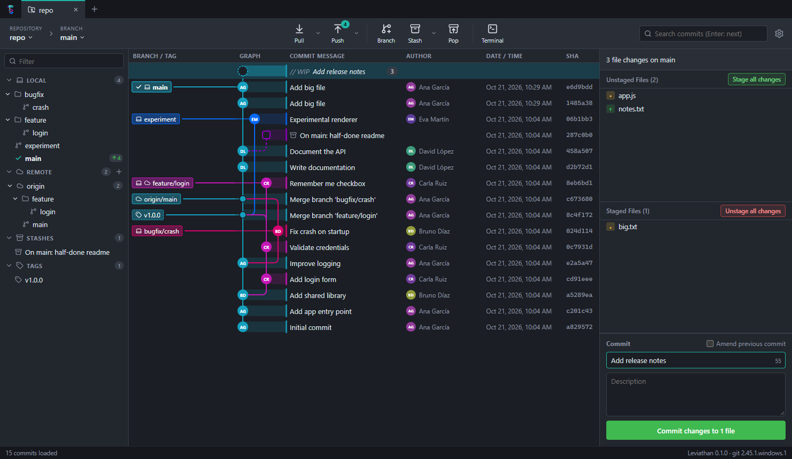

<p align="center">
  
</p>

<h1 align="center">Leviathan</h1>

<p align="center">
  A free and open source Git client with a beautiful commit graph.<br />
  <strong>No ads. No accounts. No paywalls.</strong>
</p>

<p align="center">
  <a href="#download">Download</a> ·
  <a href="#build-from-source">Build from source</a> ·
  <a href="CONTRIBUTING.md">Contribute</a> ·
  <a href="docs/ROADMAP.md">Roadmap</a> ·
  <a href="#en-español">Español</a>
</p>



## Why Leviathan?

The most comfortable Git GUIs keep their best features behind subscriptions or require an account to work with private repositories. Leviathan gives everyone the same visual workflow — tabs, a coloured branch graph, one-click staging — for free, and is built in the open by the people who use it.

## Features

- **Visual commit graph**: coloured lanes with rounded elbows, lane-coloured row bands, branch and tag labels, author initials, the work-in-progress node and stashes drawn right in the graph. Smooth with thousands of commits.
- **Tabs**: keep several repositories open; they are restored on the next start.
- **Side panel**: local branches as a folder tree, remotes, stashes and tags, with ahead/behind counters and a filter.
- **Focus the graph**: hide branches or show only one, highlight the history of a branch, and see which branches have an open pull request.
- **Staging**: stage or unstage whole files, individual **hunks** or single **lines**; select several files (checkboxes, Ctrl/Shift+click) to stage, unstage or discard them together; discard changes; add files to `.gitignore`.
- **Commits**: summary and description, amend the last commit, `Ctrl+Enter` to commit.
- **Diff viewer** for the working tree, the index and any commit, in one column or side by side, with syntax highlighting (C#, shaders, Unity assets and many more) and the words that changed highlighted.
- **File and folder history, and blame**: every commit that touched a file (following renames) with its diff, every commit that changed something in a folder with the files it changed there, and who last changed each line.
- **Branches**: create, checkout (double-click), rename, delete, merge, rebase, push, delete from the remote. **Drag a branch onto another** to merge or rebase.
- **History**: cherry-pick, revert, reset (soft / mixed / hard), checkout a commit, create tags, and **interactive rebase** — reorder (drag and drop), reword, edit, squash, fixup or drop the commits after any commit, from a dialog.
- **Remotes**: fetch, pull (fast-forward, fast-forward only, rebase), push and force-push with lease, add and remove remotes, choose the remote when publishing a branch, **automatic background fetch**.
- **Private repositories**: HTTPS usernames/tokens, SSH key passphrases and unknown host keys are asked in the app; your credential helper (for example Git Credential Manager) keeps working. List, copy and generate **SSH keys** from Settings.
- **Stash**: save (including untracked files), apply, pop, delete.
- **Conflicts**: a banner during merge/rebase/cherry-pick with *Abort* and *Continue*, and a conflict editor that shows current and incoming versions side by side so you can pick one, the other or both per block — or take a whole side of the file.
- **Clone, init and open** repositories; recent repositories list.
- **Search** commits by message, author or SHA.
- **Live refresh** when files change on disk.
- **Accounts**: **sign in with GitHub or GitLab** from the browser (no token to create; GitHub organizations that restrict OAuth apps must approve Leviathan first), or add as many GitHub, GitLab, Bitbucket, Gitea or other accounts as you like with a personal access token (stored encrypted). Each repository can use an account: commits get its name and private no-reply email (Bitbucket: the account's email), and push/pull use its token without asking. Clone straight from an account's repository list.
- **Pull requests**: see the open pull requests (merge requests on GitLab) of the repository in the side panel, **review** one (its files and diff, its comments; comment, approve, merge), check one out, or open a new one from a branch — on GitHub, GitLab, Bitbucket and Gitea, through your account.
- **Git LFS**: see which files go through LFS, lock and unlock files (yours and, with a confirmation, other people's), track patterns, and get warned before committing a big binary outside LFS or a file someone else locked. Detects a missing or unconfigured git-lfs and sets it up.
- **Submodules**: see their state in the side panel, initialize and update them, open them in a tab, see which commits a submodule change brings, and clone with them.
- **External tools**: open files in your editor (VS Code, Rider, Visual Studio… or any command), a change in your diff tool, a conflict in your merge tool and the repository in your terminal (PowerShell, Windows Terminal, Git Bash, iTerm…); and `leviathan .` in a terminal opens the repository you are in.
- **Undo / redo** (Ctrl+Z / Ctrl+Shift+Z) for commits, checkouts, branches, tags, merges, rebases, resets and pulls — without ever losing uncommitted work.
- **Automatic updates** from the GitHub releases: one click with the Windows installer and the Linux AppImage; the portable build, the .deb and macOS point to the download. The check contacts github.com every half hour (and when you come back to the app) and can be turned off in Settings.
- **What's new**: the notes of every version, from the status bar.
- **Dark and light themes**, or follow the system.
- **English and Spanish** interface (more languages welcome!).
- Uses **your installed Git**, so your config, credential helpers, SSH keys and hooks work as usual.

## Download

Installers for Windows, macOS and Linux are published on the [Releases page](https://github.com/Galderolo/Leviathan/releases).

Leviathan needs [Git](https://git-scm.com/downloads) to be installed.

> The builds are not code-signed yet (see the [code signing policy](#code-signing-policy)), so Windows SmartScreen and macOS Gatekeeper warn the first time you open the app. On Windows, click **More info** and then **Run anyway**; on macOS, right-click the app and choose **Open**. Updates installed from inside the app do not show the warning again.

To uninstall, use *Settings → Apps* on Windows (installer build), delete the app on macOS, or remove the package on Linux; the portable Windows build is a single file you can delete. Your settings and accounts live in Leviathan's folder under the user data directory (`%APPDATA%\Leviathan` on Windows).

## Build from source

You need [Node.js](https://nodejs.org) 22.12 or newer and Git.

```bash
git clone https://github.com/Galderolo/Leviathan.git
cd Leviathan
npm install
npm run dev      # start the app with hot reload
npm test         # unit + integration tests
npm run dist     # build installers into dist/
```

## Keyboard shortcuts

| Shortcut                  | Action                            |
| ------------------------- | --------------------------------- |
| `Ctrl+T`                  | New tab                           |
| `Ctrl+W`                  | Close tab                         |
| `Ctrl+Tab` / `Ctrl+Shift+Tab` | Next / previous tab           |
| `Ctrl+O`                  | Open repository                   |
| `Ctrl+F`                  | Search commits (`Enter` for next) |
| `↑` / `↓`, `PgUp` / `PgDn` | Move through the graph           |
| `Ctrl+Enter`              | Commit                            |
| `Ctrl+Z` / `Ctrl+Shift+Z` | Undo / redo                       |
| `Ctrl+P`                  | Push                              |
| `Ctrl+L`                  | Pull                              |
| `Esc`                     | Close the diff                    |
| `F5`                      | Refresh                           |
| `F12`                     | Developer tools                   |

On macOS use `Cmd` instead of `Ctrl`.

## Code signing policy

Windows releases are going to be signed through [SignPath](https://signpath.io): free code signing provided by [SignPath.io](https://about.signpath.io), certificate by [SignPath Foundation](https://signpath.org). The application is pending; until it is approved, the installers are not signed.

- **What is signed:** only the Windows installers and executables built from this repository by the [Release workflow](.github/workflows/release.yml) on GitHub Actions, from a version tag. Nothing built on a personal machine is ever signed.
- **Committers and reviewers:** [Galderolo](https://github.com/Galderolo)
- **Approvers** (every signing request is approved by hand): [Galderolo](https://github.com/Galderolo)
- **Privacy:** see the [privacy policy](#privacy-policy) below.

## Privacy policy

Leviathan collects no telemetry or usage data, has no accounts of its own and shows no ads. It only connects to other systems for what you ask it to do, plus one automatic check:

- **Your git remotes** (fetch, pull, push, clone), with the credentials you give it or your own credential helper.
- **The hosting services of the accounts you add** (GitHub, GitLab, Gitea…), to list repositories and pull requests and to sign you in. Tokens are stored encrypted on your computer and are only sent to the service they belong to. While you sign in to GitLab, the app listens on 127.0.0.1:47231 (your own computer only) for the browser to come back.
- **The Git LFS servers of your repositories**, to list and change file locks.
- **github.com, to look for new Leviathan releases**, shortly after start, every half hour and when you come back to the app (at most every ten minutes). It sends nothing about you or your repositories, and can be turned off in *Settings → Updates*. Opening *What's new* also reads the list of releases from github.com.

## Contributing

Leviathan is maintained by one person in their spare time. Issues and pull requests are welcome, but reviews may be slow and there is no guarantee that a given PR will be merged. Because Leviathan is MIT-licensed, you are always free to fork it and take it in your own direction.

If you want to contribute, start with [CONTRIBUTING.md](CONTRIBUTING.md) and the [roadmap](docs/ROADMAP.md).

Please follow our [Code of Conduct](CODE_OF_CONDUCT.md).

## License

[MIT](LICENSE). Leviathan is free software and will stay that way.

---

## En español

**Leviathan** es un cliente Git gratuito y de código abierto, con un grafo de commits visual. Sin anuncios, sin cuentas y sin pagos.

- Grafo de commits a color con ramas, merges, tags, stashes y el nodo de trabajo en curso (WIP).
- Pestañas con varios repositorios abiertos a la vez.
- Preparar (stage) archivos completos, bloques o líneas sueltas, commit, amend, diff con resaltado de sintaxis.
- Arrastrar una rama sobre otra para hacer merge o rebase.
- Repos privados: usuario/token HTTPS, passphrase SSH y huellas de host se piden en la app; gestión de claves SSH.
- Iniciar sesión con GitHub o GitLab desde el navegador (sin crear tokens), o varias cuentas (GitHub, GitLab, Bitbucket, Gitea…) con token cifrado: cada repo usa la suya para el autor de los commits (email privado por defecto) y para push/pull sin contraseñas; clonar desde la lista de repos de la cuenta.
- Pull requests (merge requests en GitLab) en el panel lateral: verlas, revisarlas (archivos, diff y comentarios; comentar, aprobar, mergear), hacer checkout y crear una desde una rama, en GitHub, GitLab, Bitbucket y Gitea.
- Editor de conflictos: versión actual y entrante lado a lado, eligiendo por bloque o el archivo entero.
- Git LFS: ver qué archivos van por LFS, bloquear y desbloquear archivos, seguir patrones y avisos antes de hacer commit de un binario grande fuera de LFS o de un archivo que otra persona tiene bloqueado.
- Submódulos: su estado en el panel lateral, inicializarlos y actualizarlos, abrirlos en una pestaña, ver qué commits trae un cambio de submódulo y clonar con ellos.
- Herramientas externas: abrir archivos en tu editor (VS Code, Rider, Visual Studio… o cualquier comando), un cambio en tu herramienta de diff, un conflicto en la de merge y el repositorio en tu terminal (PowerShell, Windows Terminal, Git Bash, iTerm…); y `leviathan .` en una terminal abre el repositorio en el que estás.
- Deshacer / rehacer (Ctrl+Z / Ctrl+Mayús+Z) commits, checkouts, ramas, tags, merges, rebases, resets y pulls.
- Fetch automático, tema claro y oscuro.
- Ramas: crear, checkout con doble clic, renombrar, borrar, merge, rebase, push.
- Historial de un archivo (siguiendo renombrados) o de una carpeta, y blame: quién cambió cada línea.
- Rebase interactivo desde cualquier commit: reordenar arrastrando, cambiar mensajes, editar, unir (squash/fixup) o descartar commits.
- Cherry-pick, revert, reset, tags, stash, fetch/pull/push, clonar y crear repositorios.
- Interfaz en español e inglés.

Los instaladores aún no están firmados: si Windows muestra "Windows protegió su PC", pulsa **Más información** y luego **Ejecutar de todas formas** (solo pasa al instalar; las actualizaciones desde la app no vuelven a avisar). Leviathan no recoge telemetría: solo se conecta a tus remotos, a los servicios de las cuentas que añadas, a los servidores LFS de tus repos y a github.com para buscar versiones nuevas (se puede desactivar en Ajustes).

Para compilarlo necesitas Node.js 22.12+ y Git: `npm install` y después `npm run dev`.

Lo mantiene una sola persona en su tiempo libre: los issues y pull requests son bienvenidos (también en español), pero la revisión puede tardar y no se garantiza que se acepten. Al ser MIT, siempre puedes hacer un fork. Más detalles en [CONTRIBUTING.md](CONTRIBUTING.md) y la [hoja de ruta](docs/ROADMAP.md).
